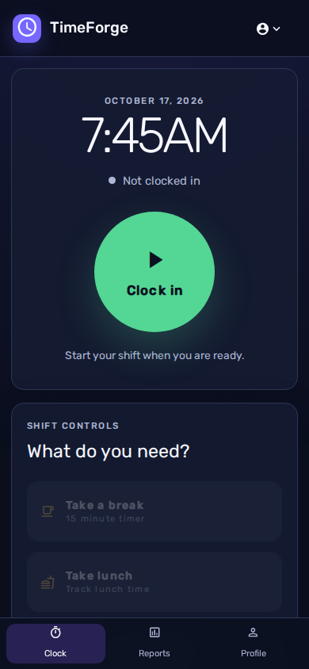
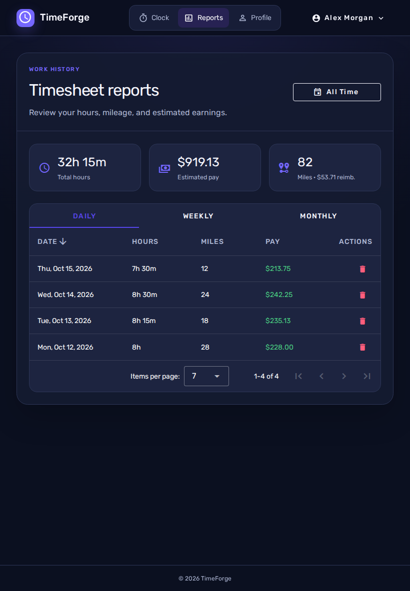
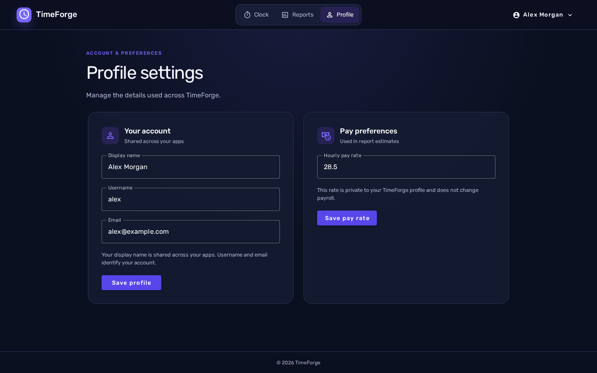

# TimeForge

A professional time tracking application built with Nuxt.js that helps you manage work hours, mileage, and calculate expected payouts.

[View Live Example](https://jaimegonzalezjr.com/Projects/TimeForge)

## Features

- 📊 Time Tracking Dashboard
- 🚗 Mileage Tracker
- 💰 Payout Calculations (Daily, Weekly, Monthly)
- 👤 Customizable User Profiles
- ⚙️ Comprehensive Settings

## Screenshots





## Tech Stack

- Frontend: Nuxt 3 with Vue Composition API and TypeScript
- Backend: Strapi Headless CMS
- Authentication: Google and existing local accounts through native Strapi authentication
- Styling: Vuetify Material Design Framework

## Prerequisites

- Node.js 20.19+ (20.x) or 22.12+; Node.js 22 LTS recommended
- npm or yarn package manager
- Docker (optional, for containerized Strapi)

## Setup Instructions

### 1. Frontend Setup (TimeForge)

```bash
# Clone the repository
git clone https://github.com/yourusername/timeforge.git
cd timeforge

# Install dependencies (using npm)
npm ci

# OR if using yarn
yarn install

# Create .env file
cp .env.example .env
```

### 2. Environment Configuration

Create a `.env` file in the root directory with the following content:

```
# Development
API_AUTH_URL=https://api.jaimegonzalezjr.com
NODE_ENV=development

# Production (update when deploying)
# API_AUTH_URL=https://api.jaimegonzalezjr.com
```

### 3. Strapi Backend Setup

```bash
# Create a new Strapi project
npx create-strapi-app@latest timeforge-backend --quickstart

# Once Strapi is running, create an admin account at:
# http://localhost:1337/admin
```

#### Required Strapi Configuration:

1. Create Content Types:

   - TimeEntry

     - date (datetime)
     - startTime (time)
     - endTime (time)
     - description (text)
     - user (relation to User)

   - MileageEntry
     - date (date)
     - miles (decimal)
     - description (text)
     - user (relation to User)

2. Configure Permissions:
   - Go to Settings → Users & Permissions Plugin → Roles
   - Edit the Authenticated role
   - Enable necessary CRUD operations for TimeEntry and MileageEntry

### 4. Running the Application

#### Development Mode

```bash
# Start Strapi backend (in timeforge-backend directory)
npm run develop
# or yarn develop

# Start Nuxt frontend (in main project directory)
npm run dev
# or yarn dev
```

The application will be available at: http://localhost:3000

#### Production Build

```bash
# Generate static files
npm run generate
# or yarn generate

# Serve the static files
npm run start
# or yarn start
```

## Deployment Options

### Frontend Deployment

You can deploy the static frontend to:

- GitHub Pages
- Netlify
- Vercel
- Any static hosting service

### Backend Deployment

For Strapi, you can:

- Use a Platform-as-a-Service (PaaS) like Heroku
- Deploy to a VPS
- Use managed services like DigitalOcean App Platform

## Contributing

Contributions are welcome! Please feel free to submit a Pull Request.

## License

This project is licensed under the MIT License - see the [LICENSE](LICENSE) file for details.

## Acknowledgments

- Built with Nuxt.js
- Styled with Vuetify
- Powered by Strapi CMS

## Authentication and deployment

TimeForge is a client-rendered SPA (`ssr: false`). `npm run generate` creates `.output/public/index.html` and its static assets. Configure your web server to serve that index for client routes such as `/login`, `/dashboard`, `/profile`, and `/auth/google`. Revalidate HTML after deployments; publish from a completed build rather than compiling inside the live web directory.

Set `NUXT_APP_BASE_URL` to `/` (default) for a dedicated domain or a subdirectory such as `/Projects/TimeForge/`. Set `NUXT_PUBLIC_API_BASE_URL` for the compatible Strapi backend. These values are public and embedded during the build. Keep host-specific paths and settings in the ignored repo-local `.env`; `.env.example` documents the public configuration.

The backend serves the shared account client at `/auth/client.v1.js` and native auth endpoints. In Strapi Admin → OAuth Applications, configure the `timeforge` application's enabled methods, registration, shared/separate session mode, callback URL (`<app URL>/auth/google`), and return URL (`<app URL>/`). Each app uses its own callback. Google provider credentials and the provider-side callback belong on the backend, never in frontend configuration.

The Profile page edits shared display name and a separate owned TimeForge pay-rate profile, created on first use. The backend must enforce ownership of profiles and timesheets. Shared sessions use the common same-origin storage key; separate sessions use an app-specific key. Break reminders run while the page is open, and unfinished clock drafts are scoped to the authenticated account. No service worker is registered.

The Google callback adds a temporary noncredential query parameter to load a fresh return document. The authenticated route guard removes it and redirects signed-in users away from login. Login and callback have a standalone layout; authenticated navigation uses the account menu.

## Testing

Run the fast test suites during development:

```sh
npm test
```

This command runs the TypeScript and Composition API guard, checks the project with `vue-tsc`, then runs all unit, routing, and security tests through Vitest. To run only the compiler, use:

```sh
npm run typecheck
```

Run the Playwright browser tests after installing Chromium:

```sh
npx playwright install chromium
npm run test:e2e
```

Synology does not provide Playwright's Linux system libraries. Run the browser test in the pinned Playwright container there:

```sh
npm run test:e2e:docker
```

Run every test suite with `npm run test:all` on a supported host. Use `npm run test:unit:watch` for Vitest watch mode or `npm run test:e2e:ui` for Playwright UI mode. The end-to-end scripts generate the app with a root base path, then serve the generated files through the local SPA test server. They do not use the configured deployment output directory.

Regenerate the README screenshots with `npm run screenshots`. On Synology, run `npm run screenshots:docker` instead. The screenshot test uses fixed account and timesheet data, and writes the mobile, tablet, and desktop views to `static/img/ss1.png`, `static/img/ss2.png`, and `static/img/ss3.png`.

Run `npm run generate` to verify the static build. Hosting and publishing are installation-specific operations rather than part of the public npm scripts.

### Dependency security patches

`npm ci` applies the checked-in `patch-package` patches before preparing Nuxt, and fails if a patch cannot be applied. Nuxt DevTools 3.4.2 uses the named `simpleGit` export so it can run with the patched `simple-git` 4.0.2 release. The pinned `node-forge` 1.4.0 dependency includes the nested DigestAlgorithm validation fix from [upstream PR #1152](https://github.com/digitalbazaar/forge/pull/1152) for CVE-2026-85393. The security tests reject a malformed RSA signature and verify that valid signatures still work.

These pins and patches are temporary: remove them when compatible upstream releases include the fixes. Dependency scanners may continue to report `node-forge` 1.4.0 because they inspect the published version rather than the patched source. Do not skip install scripts when building or running the application.

### Output directory override

The ignored repo-local `.env` can set `BUILD_OUTPUT` to a directory. Unset or empty keeps the framework's normal output folder. The framework cleans that output during generation/build, so obsolete files do not accumulate.

A local installation can point `BUILD_OUTPUT` directly at its hosted app directory and use the normal npm build/generate command without a deployment script. A failed build can leave that directory incomplete until the next successful build. Keep persistent data outside the build output. Personal paths and environment overrides remain untracked.
